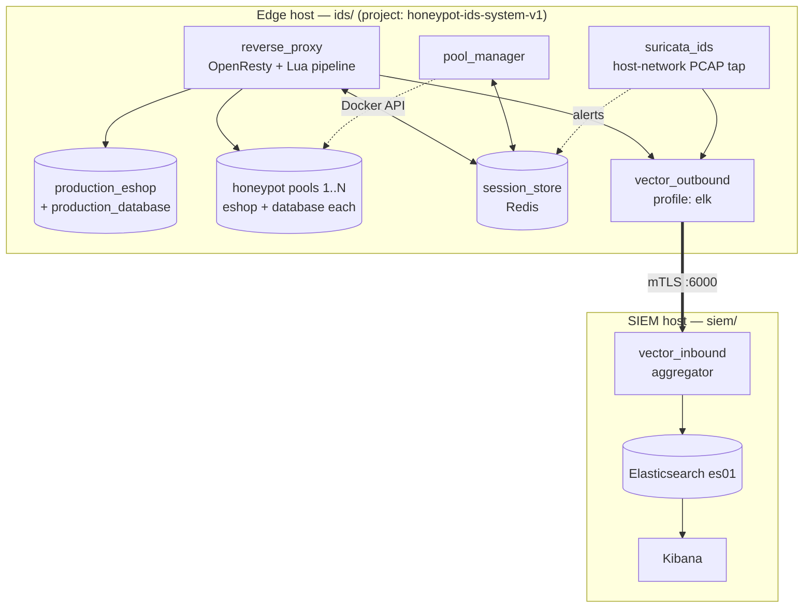

# Architecture

The system is three subsystems with their own idioms, split across two hosts:

- a **WordPress application** (production + honeypot clones) with its own hook/theme
  conventions;
- **Docker Compose infrastructure** on two independent hosts;
- the actual thesis contribution — the **Lua detection pipeline** in the reverse
  proxy.

Because it isn't one application, MVC doesn't fit. The detection pipeline instead
uses a **numbered middleware chain built from pure decision cores + thin I/O
adapters** (ports-and-adapters), which is what makes 484 unit tests possible without
a running nginx/Redis stack.

-   :material-server-network:{ .lg .middle } **[Two-Host Split](two-host-split.md)**

    ---

    Why `ids/` and `siem/` are two separate hosts and compose projects, the full
    data-flow diagram, and the one-way mTLS channel between them.

-   :material-pipe:{ .lg .middle } **[Request Pipeline](request-pipeline.md)**

    ---

    What happens to every request: scoring, session lookup, the 10-stage routing
    decision, pool assignment and sophistication classification.

-   :material-language-lua:{ .lg .middle } **[Lua Module Map](lua-modules.md)**

    ---

    Pure `*_rules.lua` cores vs. thin `*.lua` adapters, with test counts and the
    responsibility of each.

-   :material-docker:{ .lg .middle } **[Compose Services & Networks](services.md)**

    ---

    All 18 edge services, the five networks, and the one-shot jobs that seed and
    migrate data.

## The 30-second model

Start with the [two-host split](two-host-split.md) to understand the boundary, then
the [request pipeline](request-pipeline.md) for the core logic.
