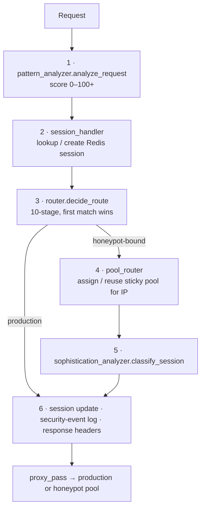

# Request Pipeline

This is the core of the thesis contribution. Every non-static request goes through
`nginx.conf`'s `access_by_lua_block`, which calls these stages **in order**:

## The stages

### 1 · `pattern_analyzer.analyze_request()`

Scores the request **0–100+** against:

- URI attack patterns (SQLi / XSS / traversal / command injection / LFI-RFI),
- headers and CVE signatures,
- IP reputation (local `threat_ips` plus AbuseIPDB),
- request method,
- automation / scanner User-Agent fingerprints.

It also runs a **Stage 7 prompt-injection probe**
([`prompt_injection_filter`](../detection/advanced.md)).

!!! info "Hot path reads the shared dict, not Redis"
    On the request path `pattern_analyzer` reads IP reputation from the in-process
    `threat_intel` shared dict, **never Redis directly**, for latency. Writers must
    mirror into both — see [State](../engine/state.md) for the bug this caused.

### 2 · `session_handler`

Looks up or creates a Redis-backed session (`session:<id>`), with a fast local mirror
in the `sessions` shared dict to skip a Redis round-trip per request.

### 3 · `router.decide_route()` — the decision

The actual production-vs-honeypot decision: a **10-stage pipeline, first match
wins**.

| # | Stage | Routes to |
|---|---|---|
| 1 | Static asset | production (cheap, never diverted) |
| 2 | Sticky already-bound session | whatever that IP is already pinned to |
| 3 | Risk score ≥ threshold (default **80**) | honeypot |
| 4 | CVE match | honeypot |
| 5 | Vulnerable-plugin-path access | honeypot |
| 6 | Bad IP reputation | honeypot |
| 7 | Repeated admin-panel probing | honeypot |
| 8 | Cumulative suspicious-activity count | honeypot |
| 9 | Rapid automation | honeypot |
| 10 | Suspicious file upload | honeypot |
| — | *(default)* | production |

This function deliberately stays an impure adapter — its staging interleaves session
mutation with Redis/AbuseIPDB I/O too deeply to extract safely. Only its
self-contained predicates (`is_static_asset`, `is_admin_access`,
`is_rapid_automation`, `is_suspicious_upload`, `is_vulnerable_plugin_access`) were
moved to [`router_rules.lua`](lua-modules.md); `decide_route()` itself is covered by
46 tests against in-memory stubs.

### 4 · `pool_router`

If the verdict is honeypot, this assigns (or reuses) a **sticky pool** for that IP via
Redis, and kicks off scaling if needed. This is the subject of
[Pool Scaling & Assignment](../engine/pooling.md).

### 5 · `sophistication_analyzer.classify_session()`

Labels the session `scripted` / `manual` / `ai_assisted` / `unknown` from timing
regularity, UA fingerprint, header completeness and payload precision. Persisted to
the session (and thus to ELK) only for already-suspicious / honeypot-bound traffic.
See [Advanced Signals](../detection/advanced.md).

### 6 · Finalize

Session update, `log_security_event()` emission (which the SIEM parses), and response
headers.

---

## No tarpit, by design

The proxy **never holds a request back**, so production and honeypot routes have the
**same proxy latency** — a user cannot tell them apart by response time. An earlier
`router.apply_botnet_slowdown()` slept 0.5–3 s for hostile/automated clients; it was
removed for exactly that reason, since per-route latency was itself a tell.

## Threshold & scoring nuance

`threat_ips[ip].raw_score` only ever rises (capped at 100). What a request's own
score actually gets is `suricata_rules.decayed_score()`'s **time-decayed** view of
it — so seeing `100` in Redis and a much smaller contribution in the proxy logs for
the same IP is expected (decay), not a bug. See [State](../engine/state.md) for the
field-naming history.

## Where to look

- [Lua Module Map](lua-modules.md) — which file does what, and its tests.
- [Detection Capabilities](../detection/capabilities.md) — what each pattern catches.
- [State](../engine/state.md) — the Redis/shared-dict keys every stage touches.
