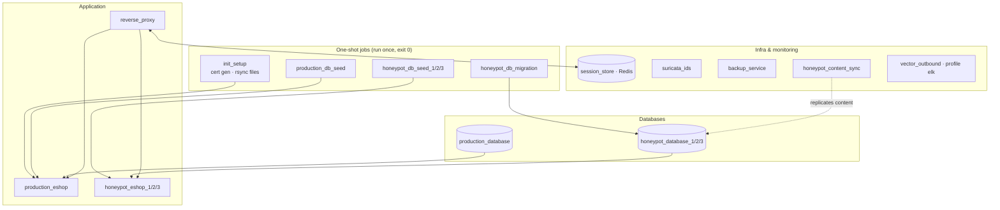

# Compose Services & Networks

The edge stack (`ids/docker-compose.yml`) defines **18 services**, verified via
`docker compose config --services`.

## Services

### The full list

`init_setup`, `honeypot_db_migration`, `production_database`, `production_db_seed`,
`production_eshop`, `honeypot_database_1/2/3`, `honeypot_db_seed_1/2/3`,
`honeypot_eshop_1/2/3`, `session_store` (Redis), `suricata_ids`, `backup_service`,
`reverse_proxy`, `honeypot_content_sync`.

!!! info "`vector_outbound` is profile-gated"
    It exists in `docker-compose.yml` but sits behind `profiles: [elk]`, so a plain
    `docker compose up` does **not** start it. Use `docker compose --profile elk up -d`.

### One-shot seed/migration jobs

`production_db_seed` and `honeypot_db_seed_1/2/3` run once and exit 0 — a
run-once-and-exit job finishing cleanly is its expected "up" state (the dashboard
counts it as up, not down). Each eshop `depends_on` its seed job with
`condition: service_completed_successfully`, so no eshop ever serves requests against
a schemaless database. See [Seeding the Storefront](../engine/seeding.md).

## Runtime-created pools

Pools 1–3 are declared in `docker-compose.yml`; `pool_manager` only *adopts* them.
Additional pools (4, 5, …) are created **at runtime via the Docker API**, so they
carry only `honeypot.pool` / `honeypot.pool.managed-by` labels — **no**
`com.docker.compose.*` labels. That's why tooling that lists containers via
`docker compose ps` (the dashboard's health diagram included) has to merge them in by
label. See [Pool Scaling](../engine/pooling.md) and
[the dashboard](../getting-started/dashboard.md).

## Networks

Five bridge networks keep the traffic planes separate:

| Network | Carries |
|---|---|
| `production_network` | reverse proxy ↔ production eshop/database |
| `honeypot_network` | reverse proxy ↔ honeypot pools |
| `monitoring_network` | monitoring/log components |
| `session_network` | Redis + `pool_manager` (which mounts the Docker socket and publishes no ports) |
| `ids_network` | legacy IDS wiring — note Suricata runs `network_mode: host`, **not** on this bridge, so it can actually see traffic (see [Suricata](../detection/suricata.md)) |

!!! warning "Bridge membership ≠ traffic visibility"
    Two containers sharing a bridge network do **not** see each other's traffic
    unless addressed to them. This is exactly why `suricata_ids` had to move to
    `network_mode: host` to detect anything — see
    [Known Issues §9.2](../reference/known-issues.md).

## Dead code, explicitly marked

`docker-compose.yml` comments out, with `# DEAD CODE:` markers, an old Node.js
Session Manager, a Python Threat Intel service, `traffic_mirror`, `log_aggregator`
and `file_sync`. The real system does all of this directly in **Lua + Redis** — see
[Known Issues](../reference/known-issues.md) for the stale-doc corrections.
