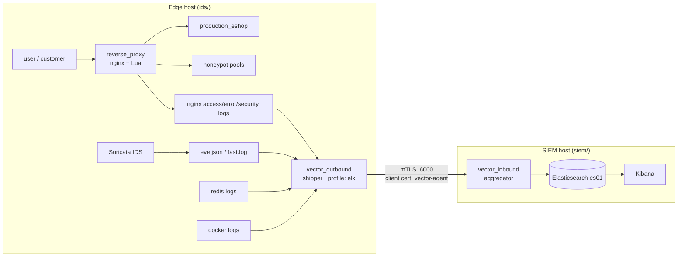

# Two-Host Split

This repository contains **two separate systems**, each with its own
`docker-compose.yml`, meant to run on **two separate hosts**.

| | Directory | Role | Compose project |
|---|---|---|---|
| **Edge host** | `ids/` | The honeypot itself: reverse proxy, WordPress (production + 3 honeypot pools), Redis, Suricata, a local Vector log shipper | `honeypot-ids-system-v1` |
| **SIEM host** | `siem/` | Log storage/analysis: Elasticsearch, Kibana, a Vector aggregator that receives the edge host's logs | directory-named |

## Why they're split

This isn't an accident of two people building unrelated things — it's a **deliberate
security boundary**.

The edge host is the one an attacker can realistically get code execution on (that's
the whole point of a honeypot). The SIEM host holds the actual telemetry about what
attackers did. Merging them into one compose file on one host would mean a honeypot
compromise is **one Docker-socket-mount or network-hop away** from the incident data
describing that same compromise.

Keeping them on separate hosts, connected by one narrow, authenticated,
**outbound-only** channel (the edge Vector shipper pushing to the SIEM Vector
aggregator over **mTLS on port 6000**), is what makes the boundary real rather than
nominal.

!!! note "Discoverability"
    Because they're separate compose projects with no shared files, a reader landing
    in one directory had no way to discover the other half existed. `ARCHITECTURE.md`
    at the repo root — and this page — are that fix.

## Data flow

Every event the edge shipper picks up is tagged with a `log_type`
(`docker`, `nginx_access`, `nginx_error`, `nginx_security`, `suricata`,
`suricata_fast`, `redis`) **before it leaves the edge host**. The aggregator's
Elasticsearch sink uses that field to route each event into its own daily index
(`honeypot-nginx_access-2026.08.05`, `honeypot-suricata-2026.08.05`, …). See
[the SIEM pipeline](../observability/siem.md).

## The narrow channel

- **Direction:** outbound only, edge → SIEM. The SIEM host never connects into the
  edge.
- **Transport:** mTLS on port 6000. The aggregator verifies the shipper's client
  certificate (`vector-agent.crt/key`); the shipper verifies the aggregator against a
  private CA minted specifically for this one pairing.
- **Ports don't collide:** `80`/`443` for the edge stack vs. `9200`/`5601`/`6000` for
  the SIEM stack — which is also why [both can run on one host](../operations/single-host.md)
  for testing without merging them.

## Running it

- [Running on Two Hosts](../operations/two-host.md) — the real deployment: cert
  generation, the manual client-cert copy, `VECTOR_HOST`, and the SAN list.
- [Single-Host Testing](../operations/single-host.md) — both projects on one machine
  via `host.docker.internal`, verified working.

## See also

- `ARCHITECTURE.md` at the repo root — the canonical write-up this page is based on.
- [Compose Services & Networks](services.md) for what runs on the edge host.
- `architecture.canvas` (open the repo root as an Obsidian vault) for the
  component-level diagram.
