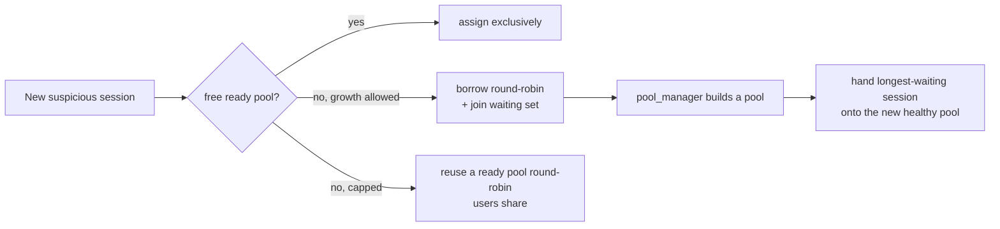

# Pool Scaling & Assignment

Each hostile IP gets a honeypot **pool** to itself — a `honeypot_eshop_N` container
plus its own `honeypot_database_N`. This page covers how pools are assigned, how new
ones are built fast, how sessions wait for and are handed pools, the resource caps,
and scale-down.

## Assignment — one pool per IP

```mermaid
sequenceDiagram
    participant RP as pool_router.lua
    participant R as Redis
    participant PM as pool_manager
    RP->>R: EVAL — pop a free ready pool, record IP as owner (atomic)
    R-->>RP: pool N (or none free)
    RP->>R: honeypot_pool_ip:<IP> = N (24h, refreshed per hit)
    RP->>R: queue wake-up on honeypot_pool:provision
    R-->>PM: (wakes) keep POOL_SPARES ready; build more
```

1. `pool_router.lua` asks Redis for a **free ready pool** with one atomic `EVAL`; the
   pool is removed from `honeypot_pool:free` and the IP recorded as its owner, so two
   users can't be handed the same pool. The IP keeps that pool for **24 h**
   (`honeypot_pool_ip:<IP>`).
2. Every assignment queues a wake-up on `honeypot_pool:provision`. `pool_manager`
   keeps `POOL_SPARES` unowned pools ready, building more pairs (pool 4, 5, …) through
   the Docker API. Before a new pool is registered ready, production's current pages,
   posts and products are mirrored into its database, so it never serves the
   install-time snapshot and a diverted visitor's cart (rebuilt from product IDs) is
   not lost.
3. Pools 1–3 come from `docker-compose.yml`; `pool_manager` only adopts them. A pool
   left half-built by a `pool_manager` restart is removed when it starts again.

!!! info "Before this change"
    The router did `INCR counter % 3`, so the 4th user already shared pool 1.
    Exclusive assignment fixed that.

## Fast builds — the template clone

Building a new pool used to dump production each time (~**44 s**). Now `pool_manager`
pre-builds a **template** once and copies it, so a new pool is ready in roughly
**MySQL's start time**.

=== "Database layer"

    `pool_manager` clones + scrubs one honeypot database into a **template** data
    directory once (pre-built at start-up, rebuilt when older than
    `POOL_TEMPLATE_TTL_SECONDS`, `0` = never), shuts its MySQL down cleanly, and each
    new pool is built by **copying that directory** and starting MySQL on it.

=== "WordPress layer"

    The same template mechanism covers the heavier build: the files + database volume
    pair is seeded **once** — production files, a database clone, migrations and the
    one-time WordPress install (`wp-cli`, ~50 s), keeping production's baseline DB
    password. Each new pool then **copies both volumes**, rotates the DB password to
    its own, and syncs the current catalog — so the slow `wp-cli` install is skipped
    per pool.

!!! note "Fallbacks"
    `POOL_TEMPLATE=0` restores the per-pool clone. While the template is still
    (re)building, pools clone from production directly (DB layer) or fall back to the
    full from-scratch build (WordPress layer).

## Scaling with the sessions

If no pool is free while growth is still allowed, the new session **borrows a ready
pool round-robin** and joins `honeypot_pool:waiting` (a sorted set, capped to 200,
scored by when it started waiting).

`pool_manager` builds one pool per waiting session (`POOL_PARALLEL_BUILDS` at a time)
and, as each becomes healthy, **atomically moves the longest-waiting session onto it**.
The router caches a waiting session's pool for only a few seconds, so the move takes
effect on its next requests; the cart follows in its cookie.



## Resource limit

Scaling stops once the next pool would exceed the budget for all pools together, from
the containers' own limits:

- **WordPress pool:** 1536 MB / 1.5 CPUs
- **Database-layer pool:** 512 MB / 0.5 CPUs
- counted against `POOL_MAX_MEMORY_MB` / `POOL_MAX_CPUS` (pools 1–3 included), or
  `POOL_MAX`.

`pool_manager` then sets `honeypot_pool:capped`; sessions still waiting keep the pool
they borrowed, and every further session **reuses a ready pool round-robin**. This is
the only case where two users keep sharing a pool.

### Low host resources

On top of the budget, `pool_manager` builds only while the host has room: free memory
above `POOL_MIN_FREE_MEM_MB`, load per CPU below `POOL_MAX_LOAD_PER_CPU`, and disk
above `POOL_MIN_FREE_DISK_GB`. Otherwise it caps the same way. When a pool's users have
all expired, it destroys the pool and builds a clean spare if the host has room
(`POOL_RECYCLE_IDLE`), or hands it to the next user as-is.

## Scale-down

`pool_router.lua` stamps each pool's last request in `honeypot_pool:last_seen`. Once no
request has reached a pool for `POOL_IDLE_TIMEOUT_SECONDS` (default **1800**, `0` =
never, at least 600 because nginx caches a session's pool for 300 s), `pool_manager`
drops its users' assignments (a returning user is assigned afresh), then removes
runtime pools — **used ones first** — until only `POOL_SPARES` unowned pools remain,
freeing their memory, CPU and volumes. Pools 1–3 are only freed, never removed.

A client can force this immediately for named sessions
(`honeypot_pool:release` + `honeypot_pool:scaledown_now`); the dashboard's pool test
does that at the end of its report. A forced scale-down that finds a pool still
building waits for it, then removes it if not needed, before reporting
`scaledown_done`.

## Measuring it

`pool_manager` logs every build (with per-phase timings), every hand-over (with how
long the session waited) and every resource-limit change to `honeypot_pool:events`.

The dashboard's **Pool test** page runs 3–10 browser windows and renders a PDF report
drawing the run as a timeline: per-pool build time by phase, borrow durations,
page-load latency on production / own / borrowed / shared pools, both round-robin
cases, and a forced scale-down at the end with memory/CPU/container counts before and
after on a `docker stats`-sampled chart. See
[the dashboard](../getting-started/dashboard.md).

## Config knobs

| Variable | Meaning |
|---|---|
| `POOL_MODE` | `wordpress` (eshop + database pools) or `database` (database pools only) |
| `POOL_SPARES` | Unowned ready pools to keep available |
| `POOL_MAX` | Hard cap on total pools |
| `POOL_MAX_MEMORY_MB` / `POOL_MAX_CPUS` | Resource budget across all pools |
| `POOL_PARALLEL_BUILDS` | Concurrent pool builds |
| `POOL_TEMPLATE` | `0` disables the template fast-clone (per-pool clone instead) |
| `POOL_TEMPLATE_TTL_SECONDS` | Rebuild the template when older than this (`0` = never) |
| `POOL_IDLE_TIMEOUT_SECONDS` | Idle time before a pool's users are dropped (default 1800, min 600) |
| `POOL_MIN_FREE_MEM_MB` / `POOL_MAX_LOAD_PER_CPU` / `POOL_MIN_FREE_DISK_GB` | Host-resource floors for building |
| `POOL_RECYCLE_IDLE` | Rebuild a clean spare after a pool's users expire |
| `POOL_POLL_SECONDS` | `pool_manager` loop interval |

## Testing

- `lua/tests/test_pool_assignment.lua` runs the real assignment script against an
  in-memory Redis and checks the exclusive, pending (scale-up) and capped reuse paths.
- `images/pool_manager/test_manager_reconcile.py` runs the hand-off against a real
  Redis.

`pool_manager` mounts the Docker socket, so it sits only on `session_network` and
publishes no ports.

See [State](state.md) for every `honeypot_pool:*` key, and
[Compose Services](../architecture/services.md) for how runtime pools differ from the
compose-declared ones.
