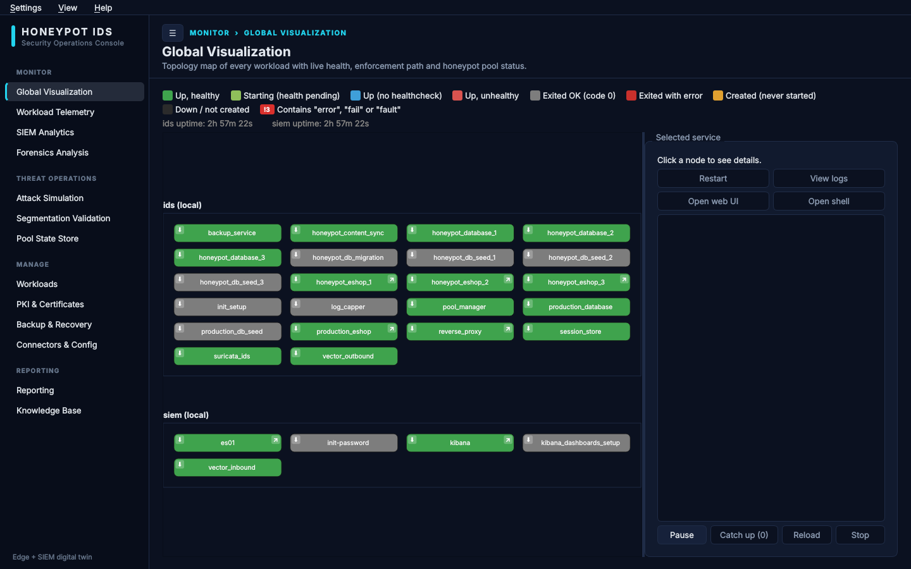
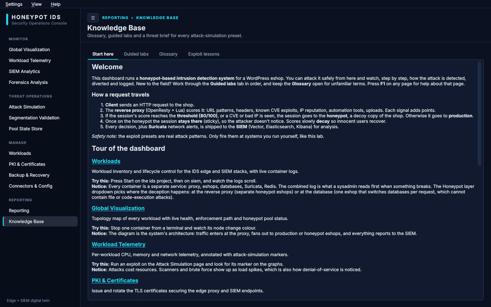
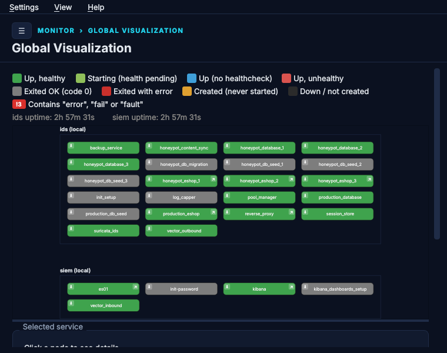
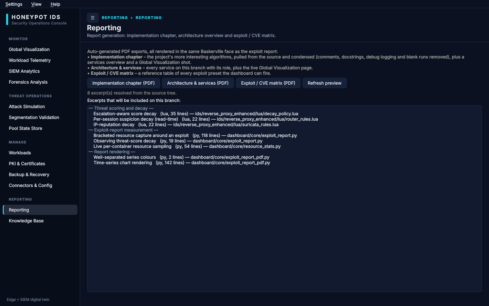

# The Dashboard

A **PyQt6 desktop app** for controlling both compose projects (`ids` and `siem`)
without hand-typing `docker compose` — local **or** remote over SSH — with a live
health diagram, log viewing, certificate management and `.env` editing.

{ loading=lazy }

## Run it

```bash
cd dashboard
./run.sh
```

First run creates a venv (`dashboard/venv/`, gitignored) and installs
`requirements.txt` automatically, then launches the app. Later runs launch directly.

There is also a `Dashboard.desktop` launcher for a normal menu/dock entry — edit its
`Exec=`/`Path=` lines if you clone the repo somewhere other than its baked-in path.

## The setup wizard

On first launch (no `state.json`), a wizard walks through, per project: the
remote/local choice, then its `.env` (a remote project fetches the `.env` **live**
over SSH and prefills the same form), then optional initial certificate generation.
A step-timeline strip at the top shows the whole run at a glance. Re-run it anytime
from **Settings → Re-run setup wizard…** without losing existing values.

## Pages

<div class="grid cards" markdown>

-   :material-play-box:{ .lg .middle } **Services**

    ---

    Start / Restart / Stop / Purge each project (local and remote), with a live
    status summary and auto-tailing combined logs. Start/Restart/Stop/Purge all
    show a **progress bar driven by real container status**, not just the compose
    command's instant exit. A one-shot job that exits 0 counts as "up".

-   :material-graph:{ .lg .middle } **Health**

    ---

    A live, auto-refreshing diagram of every container across all targets, grouped
    by project. Node color = status (healthy / running / unhealthy / exited-ok /
    exited-with-error / **created** / down). Per-node: export logs, open web UI,
    and a red **"!N"** error badge that counts log lines containing "error" or
    "fail…"/"fault…". Click a node to tail its logs; click the badge for an
    error-only `--tail=all` view.

-   :material-certificate:{ .lg .middle } **Certificates**

    ---

    Regenerate the SIEM CA + all service certs, a single service's cert, or the
    edge host's nginx SSL cert. Regenerating the `vector-agent` client cert
    re-copies it to the edge host automatically.

-   :material-text-search:{ .lg .middle } **Log Search**

    ---

    Grep-style search across every selected target's containers at once.
    **Collapse repeated lines** (on by default) folds a run of identical matches
    into one `(×N)` line so a crash loop doesn't bury everything else.

-   :material-cog:{ .lg .middle } **Settings**

    ---

    Per-project `.env` editing (Local or live Remote), SSH remote config + test,
    status-refresh interval, tray notifications, and whole-config export/import as
    one JSON file.

-   :material-school:{ .lg .middle } **Learn**

    ---

    A teaching layer for students: a "Start here" tour, five guided labs, a
    searchable glossary, and a lesson per attack-pattern preset (attack class,
    OWASP Top 10, MITRE ATT&CK, how it works, how to defend).

</div>

{ loading=lazy }

## The health diagram, specifically

The **Global Visualization** page keys each node by its compose **Service** name and
color-codes it from `docker compose ps` status. It now also surfaces
**runtime-created honeypot pools** (pools 4, 5, …) that `pool_manager` spins up
beyond the compose-declared 1–3 — those carry only `honeypot.pool` labels, not
`com.docker.compose.*` ones, so they're merged in by label query. The diagram
auto-scales nodes and text together to fit any window width and never forces
horizontal scrolling.

{ loading=lazy }

## Pool scaling report

The **Pool test** page runs 3–10 browser windows against the stack, then renders a
PDF timeline report: per-pool build time by phase, how long each window borrowed a
pool, page-load latency on production / own / borrowed / shared pools, both
round-robin cases, and a forced scale-down at the end — with memory, CPU and
container counts before and after, on a `docker stats`-sampled chart.

{ loading=lazy }

## Remote (SSH) targets

Each project can independently have a remote target (host, port, SSH user, key path,
remote project directory). Once **Test connection** succeeds you can upload just the
`.env`, or `rsync` the **whole project** to the remote host (runtime data —
backups, logs, DB/Redis volumes — is excluded). This is how the real two-host
deployment is driven from one place.

## State

`dashboard/state.json` (gitignored) holds window geometry, last page, remote
settings, poll interval and the tray toggle. It does **not** hold `.env` contents —
those live in the real `.env` files the app edits directly, so `docker compose` and
the app always see the same configuration.

!!! info "Testable core"
    `dashboard/core/` has **no PyQt imports** — pure logic (command construction,
    `.env` parsing, cert generation), verified headless against the real repo before
    any UI was written on top. See `dashboard/README.md`.
