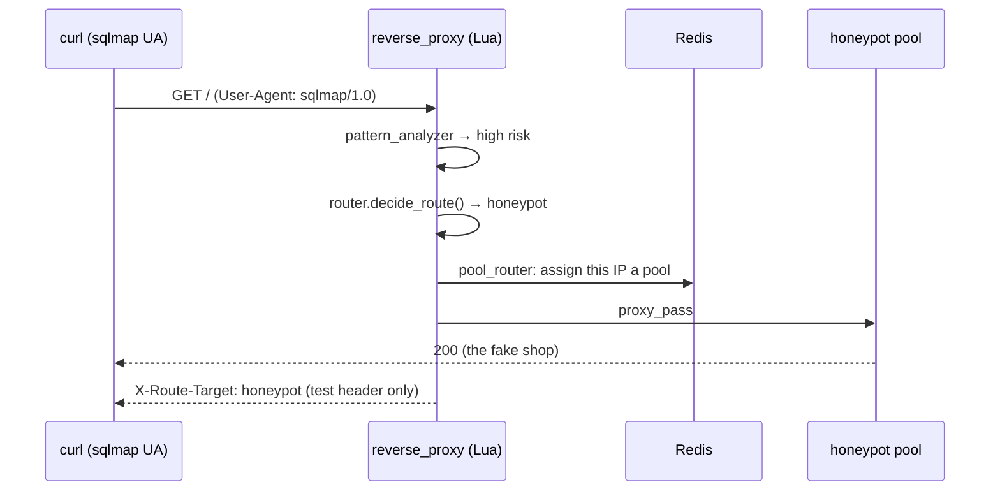

# First Attack in 5 Minutes

This walkthrough brings the edge stack up and shows a request getting **diverted**
from production to a honeypot pool in real time.

## 1. Bring the stack up

```bash
cd ids
cp .env.example .env     # set/generate secrets — see Installation
docker compose up -d --build
```

Wait until the containers are healthy. The quickest check:

```bash
docker compose ps
```

Or use the dashboard's [Health diagram](dashboard.md) for a live, color-coded view.

## 2. Export the test secret

The routing decision is echoed back in the `X-Route-Target` header **only** when a
request carries the matching internal-test header — otherwise it stays hidden (so a
real attacker can't read the verdict). Export the secret from `.env`:

```bash
export INTERNAL_TEST_SECRET=$(grep INTERNAL_TEST_SECRET .env | cut -d= -f2)
```

## 3. Send a clean request → production

```bash
curl -H "X-Internal-Test-Auth: ${INTERNAL_TEST_SECRET}" \
     https://localhost/ -k -I | grep -i x-route-target
```

Expect `X-Route-Target: production`. A normal browser visit lands on the real shop.

## 4. Send a scanner request → honeypot

Now send the same request with a flagged scanner User-Agent:

```bash
curl -H "X-Internal-Test-Auth: ${INTERNAL_TEST_SECRET}" \
     -H "User-Agent: sqlmap/1.0" \
     https://localhost/ -k -I | grep -i x-route-target
```

Expect `X-Route-Target: honeypot`. The request has been diverted, and the client IP
is now pinned to a honeypot pool for 24 hours.

## 5. Trip a seeded CVE

```bash
curl -H "X-Internal-Test-Auth: ${INTERNAL_TEST_SECRET}" \
     -X POST -H "X-WCPAY-PLATFORM-CHECKOUT-USER: 1" \
     https://localhost/wp-json/wp/v2/users -k
```

That header pattern is the [CVE-2023-28121](../detection/cves.md) WooCommerce
Payments signature — an instant honeypot route.

## 6. Watch it happen

In another terminal, tail the proxy log — every request logs its score, decision and
the stage that triggered it:

```bash
docker compose logs -f reverse_proxy
```

And the network IDS:

```bash
tail -f suricata_logs/fast.log
```

---

## What just happened



- The [request pipeline](../architecture/request-pipeline.md) scored the request and
  decided the route.
- [`pool_router`](../engine/pooling.md) pinned your IP to an isolated pool and will
  keep it there for 24 h — subsequent requests from you now consistently hit the same
  fake environment.
- Suricata saw the traffic on the network layer and raised its own alerts.

## Reset between runs

Flush all Redis state (sessions, threat scores, pool assignments) to start clean:

```bash
docker compose exec -T session_store redis-cli \
  -a "$(grep REDIS_PASSWORD .env | cut -d= -f2)" FLUSHALL
```

To rebuild the whole demo storefront, see [Seeding the Storefront](../engine/seeding.md).

## Next steps

- Explore the full [scripted scenarios](../testing/index.md) (`testing/scenario_01-09*.sh`).
- Read how the [10-stage routing decision](../architecture/request-pipeline.md) is made.
- Spin up the [SIEM](../observability/siem.md) and watch attacks land in Kibana.
