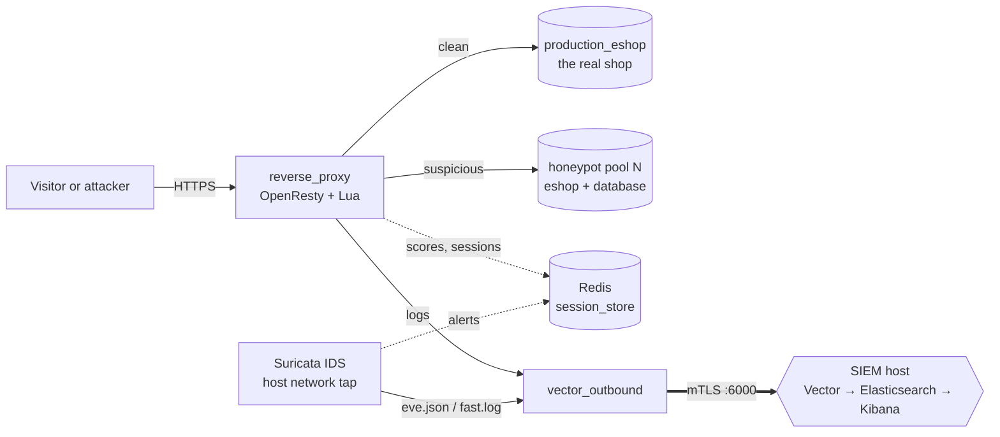

# Honeypot IDS System

<em>Zlepšenie efektivity honeypot nástroja pomocou zvýšenia úrovne interakcie</em> 
<strong>Improving Honeypot Tool Efficiency by Increasing Interaction Level</strong>

A WordPress/WooCommerce storefront that **looks and behaves like a real shop** — but
sits behind an OpenResty (Nginx + Lua) reverse proxy that **scores every request in
real time** and transparently diverts suspicious sessions into one of several
isolated, full-fidelity **honeypot clones**. Legitimate customers never notice;
attackers get a convincing, exploitable target while every move is recorded.

!!! abstract "At a glance"
    - **High interaction, not low.** The decoy is a complete WordPress site with
      WooCommerce, Elementor, a real catalog and seeded, publicly-exploitable CVEs —
      not a canned banner.
    - **Per-attacker isolation.** Each hostile IP gets its own honeypot *pool*
      (WordPress container + database), so one attacker can never see or wreck
      another's environment, and their session state (cart, uploads) persists.
    - **Elastic pools.** New pools are cloned from a pre-built template in roughly
      MySQL's start time instead of a ~44 s from-scratch rebuild, and scale down
      when idle.
    - **Full telemetry.** Lua request scoring + Suricata network IDS + Redis session
      state, optionally shipped over mTLS to a separate Elasticsearch/Kibana SIEM.
    - **A desktop control panel.** A PyQt6 dashboard runs, watches, heals and
      visualizes both halves of the system — no hand-typed `docker compose`.

This is a master's thesis project for the **Institute of Computer Engineering and
Applied Informatics, FIIT STU** (field: *Combined security solutions*).

---

## Start here

-   :material-rocket-launch:{ .lg .middle } **Getting Started**

    ---

    Bring the stack up, fire your first attack, and watch it get diverted — in
    about five minutes.

    [:octicons-arrow-right-24: Installation & setup](getting-started/installation.md)

-   :material-sitemap:{ .lg .middle } **Architecture**

    ---

    Two hosts, two compose projects, one request pipeline. How a request travels
    from the proxy to a verdict.

    [:octicons-arrow-right-24: The two-host split](architecture/two-host-split.md)

-   :material-bee:{ .lg .middle } **Honeypot Engine**

    ---

    The WordPress layer, pool scaling, per-IP stickiness, seeding, backups and the
    Redis state behind it all.

    [:octicons-arrow-right-24: How pooling works](engine/pooling.md)

-   :material-radar:{ .lg .middle } **Detection**

    ---

    What trips the detector: generic attack patterns, 9 seeded CVEs, Suricata
    network alerts, and sophistication/honeytoken signals.

    [:octicons-arrow-right-24: Detection capabilities](detection/capabilities.md)

-   :material-chart-box:{ .lg .middle } **Observability**

    ---

    The Vector → Elasticsearch → Kibana pipeline and the five dashboards built on
    top of it.

    [:octicons-arrow-right-24: SIEM & log pipeline](observability/siem.md)

-   :material-book-open-variant:{ .lg .middle } **Reference**

    ---

    Glossary, known issues, roadmap, changelog, literature, and the complete
    long-form technical manual.

    [:octicons-arrow-right-24: Reference index](reference/index.md)

---

## How it works, in short

1. Every non-static request passes through the proxy's `access_by_lua_block`.
2. [`pattern_analyzer`](architecture/request-pipeline.md) scores it (0–100+) against
   SQLi/XSS/traversal patterns, CVE signatures, IP reputation and automation
   fingerprints.
3. [`router.decide_route()`](architecture/request-pipeline.md) runs a 10-stage,
   first-match-wins decision: clean traffic stays on production; anything suspicious
   is pinned to a honeypot pool.
4. [`pool_router`](engine/pooling.md) hands that IP its own isolated pool and keeps it
   for 24 h, so the attacker sees a consistent, stateful fake world.
5. Everything is logged — locally for the dashboard, and optionally shipped to the
   [SIEM](observability/siem.md).

!!! tip "The proxy has no tarpit"
    It never holds a request back. Production and honeypot routes have **identical
    proxy latency**, so an attacker cannot tell them apart by response time. An
    earlier per-route slowdown was removed for exactly that reason.

---

## The two halves

| | Directory | Role | Compose project |
|---|---|---|---|
| **Edge host** | `ids/` | The honeypot itself: reverse proxy, WordPress (production + honeypot pools), Redis, Suricata, local Vector shipper | `honeypot-ids-system-v1` |
| **SIEM host** | `siem/` | Log storage/analysis: Elasticsearch, Kibana, Vector aggregator | directory-named |

These are **two independent systems on two hosts**, connected only by a narrow,
authenticated, outbound-only mTLS channel. That separation is a
[deliberate security boundary](architecture/two-host-split.md), not an accident — a
honeypot compromise must never be one hop from the data describing it.

!!! note "About this knowledge base"
    Every page here is derived from the running system and current source, not copied
    forward from older docs. The single long-form
    [Technical Manual](MANUAL.md) remains the canonical reference; this site
    reorganizes and expands it into a navigable, cross-linked knowledge base.
